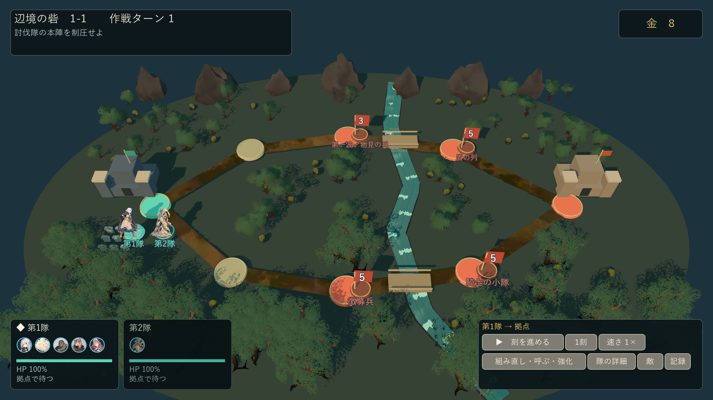
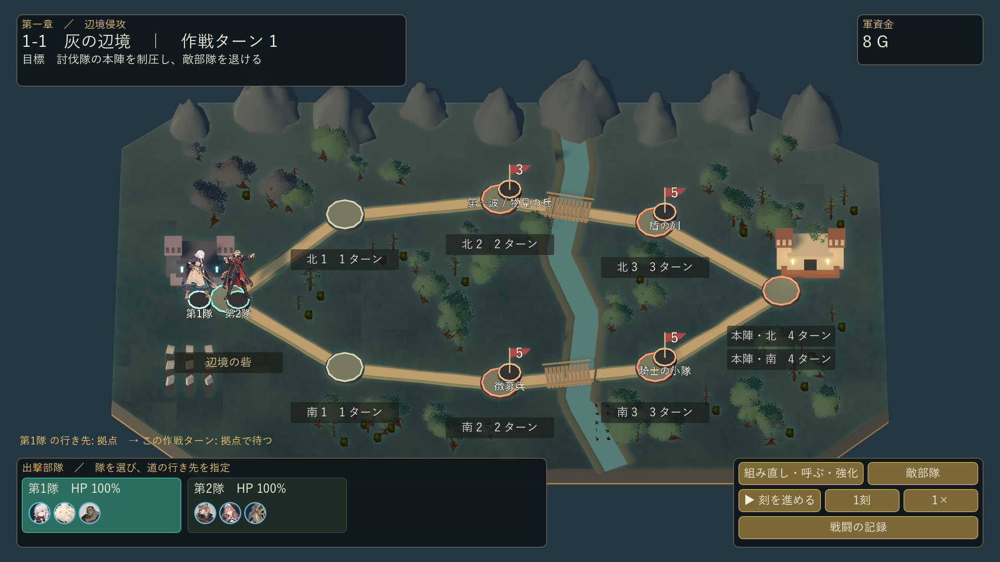
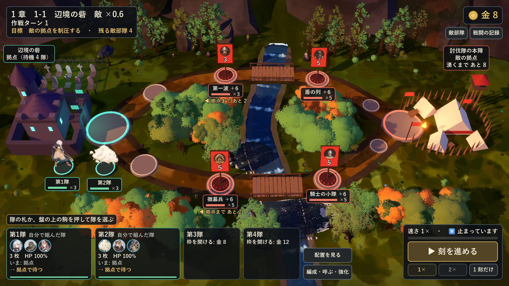
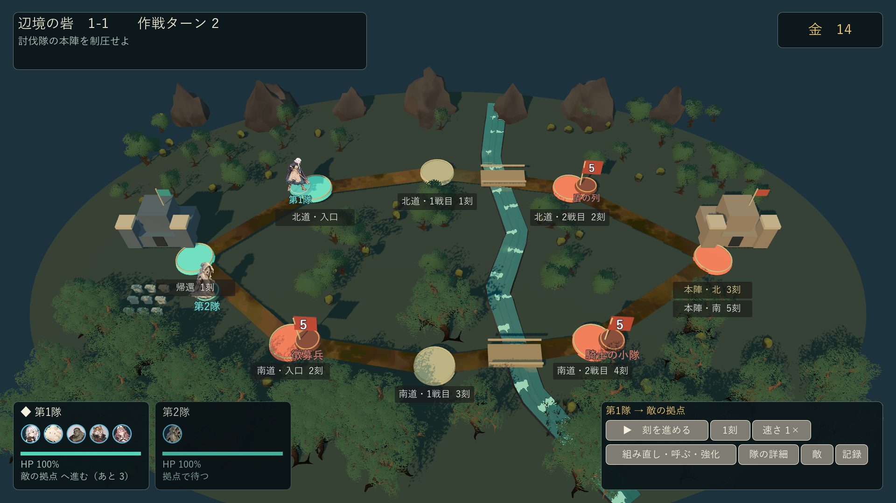
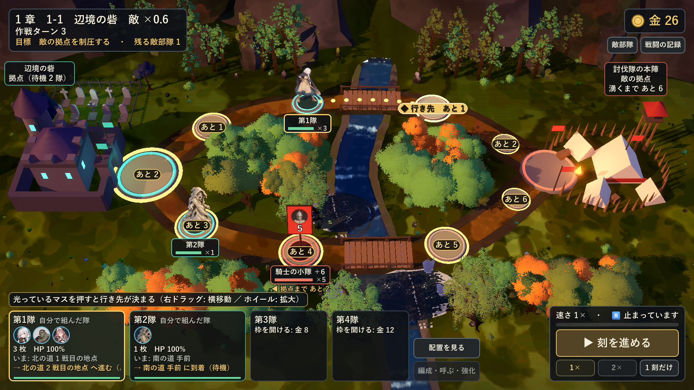
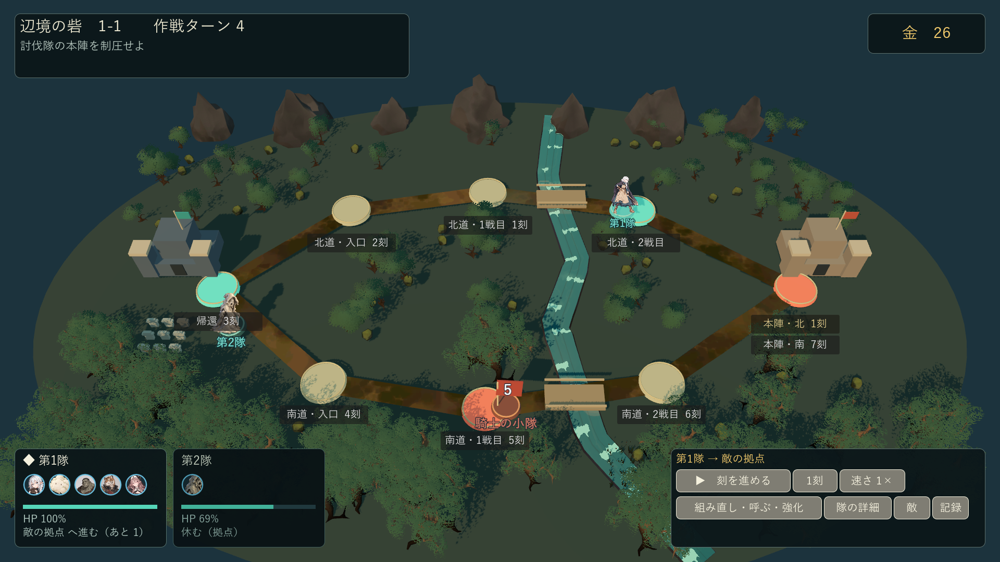
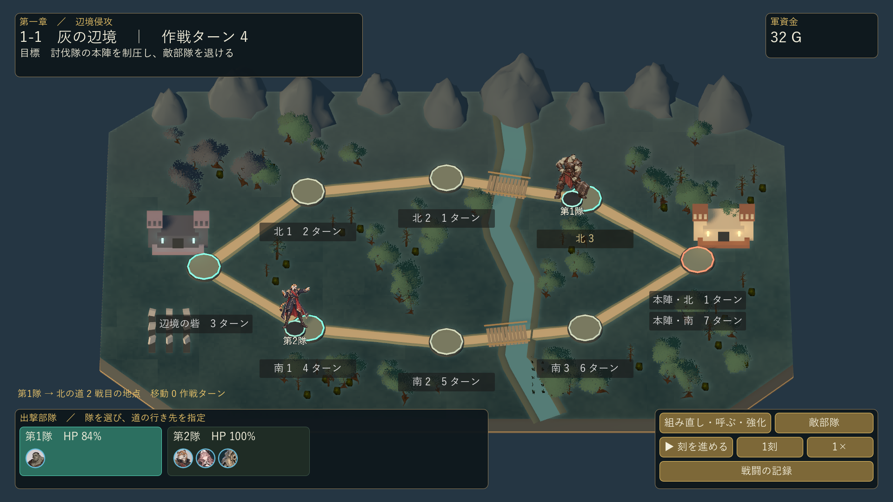
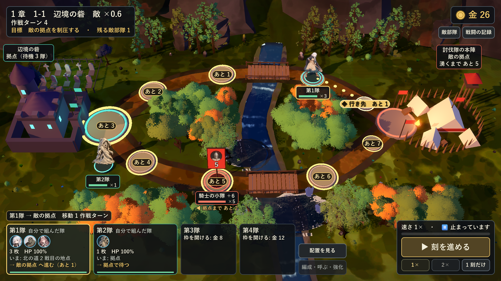

# 1-1 のジオラマ —— 3 本の比較報告

2026-11-14。発注は `BRIEF_MAP3D_STAGE11.md`（§7 が比べ方）。土台は master の `31ef7675`。
同じ発注書・同じ土台から、3 つの担当が互いを見ずに見た目の段（§2-2 ジオラマ・§2-3 動き・§2-4 UI）を作った。
**規則は 3 本とも 1 行も変えていない。push・master へのマージはしていない。**

## 0. 結論

- **土台に採るなら Claude Code 版**を薦める。駒・名札・行き先の見せ方がいちばん作り込まれていて、盤の上の情報が読める
- **Astra 版から取り入れたいもの**: 厚い地形台に載せた引きの構図と、落ち着いた色。盤の全体はこれがいちばん読みやすい
- **Sol 版から取り入れたいもの**: 特に無い（Astra 版と方向が近く、名札の読みやすさで Astra 版に劣る）
- **どれも手で遊んでの確かめをしていない。** 決める前に 3 本を一度ずつ触ること（§6 の起動）

## 1. 3 本の素性

| | Codex・Sol 版 | Codex・Astra 版 | Claude Code 版 |
|---|---|---|---|
| モデル | `gpt-6.1-sol`（high）※ | `gpt-6-astra`（high） | Claude（Claude Code のセッション） |
| 枝 | `map3d-codex` | `map3d-codex-astra` | `claude/map3d-claude-867388` |
| コミット | `36fa7b03` | `8d962378` | `243de425` |
| 作業ツリー | `C:\works\VillainProto-map3d-codex` | `C:\works\VillainProto-map3d-astra` | `C:\works\VillainProto\.claude\worktrees\competent-kirch-7c6bcd` |
| 各自の報告 | `design/MAP3D_STAGE11_codex.md` | `design/MAP3D_STAGE11_astra.md` | `design/MAP3D_STAGE11_claude.md` |
| DemoApp の差分 | 6 ファイル ＋714 ／ −32 | 9 ファイル ＋689 ／ −10 | 12 ファイル ＋2,769 ／ −19 |
| うち今の画面のファイルへの分岐 | 2 ファイル ＋16 ／ −2 | 3 ファイル ＋16 | 5 ファイル ＋45 ／ −14 |

※ Sol 版のモデルは Codex の設定ファイルからの推定（実行ログにモデル名は残らない）。Astra 版はこの 1 回だけ上書きして指定した。

## 2. 写し（1920×1080・seed 11）

### 開始時

| Codex・Sol 版 | Codex・Astra 版 | Claude Code 版 |
|---|---|---|
|  |  |  |

### 隊が動いた後

| Codex・Sol 版 | Codex・Astra 版 | Claude Code 版 |
|---|---|---|
|  |  |  |

### 敵の本陣の手前

| Codex・Sol 版 | Codex・Astra 版 | Claude Code 版 |
|---|---|---|
|  |  |  |

**写しの条件は完全には揃っていない。** 1 章には既定の組み方が無く、最初の 2 本は配属を各自で決めた。

| | Sol 版 | Astra 版 | Claude Code 版 |
|---|---|---|---|
| 配属 | 第1隊 5 枚・第2隊 1 枚 | 3 枚・3 枚 | 3 枚・3 枚 |
| 第2隊の動き | 拠点で待つ | 南の道の手前まで出る | 南の道の手前まで出て、3 枚目では拠点で番 |
| 途中の戦闘 | 器具が決着 | 本物の戦闘の結果のまま（第1隊が 1 枚に減る） | 器具が決着 |

## 3. 見た目の違い

| | Sol 版 | Astra 版 | Claude Code 版 |
|---|---|---|---|
| 構図 | 丸い島を引いて見せる。周りが暗く空く | 厚い板の地形台。盤の全体が 1 画面に収まる | 画面いっぱいの箱庭。奥の山は裾だけ入る |
| カメラ | 透視・傾き 52°・高さ 46・画角 40° | 平行投影・傾き 52°・高さ 55・表示範囲 58 | 透視・傾き 52°・高さ 45・画角 30° |
| 拡大と横移動 | ホイール／中ボタンのドラッグ | ホイール／中ボタンのドラッグ・左右キー・Home | ホイール／右ドラッグ・矢印と WASD・Home |
| 光 | 夕方の主光＋青の補助光 | 夕日の暖色＋青灰の環境光・SSAO | 夕日＋紫の影・グロー・SSAO・奥行きの霞・画面の縁を落とす |
| 色の印象 | 暗めで地味 | 青灰と苔色。いちばん落ち着いている | 橙の木と紫の影。いちばん派手 |
| 地形 | 低い起伏・木と岩・山 7 つ | 平らな台・森は低め・山は奥に 1 列 | 起伏と場所ごとの色・川は掘ってある・素材 399 個／25 種 |
| 建物（仮の箱） | 砦と本陣が同じ形の色違い | 砦と本陣（窓に灯り）・墓碑 | 砦・墓石の並ぶ墓地・天幕と柵とかがり火の本陣・板張りの橋 |
| 味方の駒 | 立ち絵の板が小さめ・名札は地面の文字 | 中くらい・台座が小さい・名札は地面の文字 | 大きめ・奥へ 24° 倒して顔を向ける・名札は札（HP と枚数） |
| 敵の駒 | 旗＋数・名札が台の上で沈む | 旗＋数・名札が橋や台と重なる | 顔の紋入りの旗＋数・足元に兵の小駒・名札は札（「拠点まで あと n」つき） |
| マスの台 | 色つきの円い台 | 縁だけ色のついた八角の台 | 色の輪の円い台・行ける先は金の輪で光る |
| 行き先の出し方 | マスの下に「北道・1戦目 1刻」の札 | マスから離れた所に「北2 2ターン」の札 | マスの上に「あと n」・今の行き先は「◆ 行き先」・経路は流れる金の点線 |
| 歩き方 | 今の滑る動きに上下の揺れ | 経路の点を辿って 0.4 秒 | 道の曲線に沿って 0.4 秒・3 歩ぶん跳ねる |

## 4. UI の違い

| | Sol 版 | Astra 版 | Claude Code 版 |
|---|---|---|---|
| 左上 | ステージ名・作戦ターン・目標 | 章の名前・ステージ名・作戦ターン・目標 | 章・ステージ名・敵の倍率・作戦ターン・目標・残る敵部隊 |
| 右上 | 金 | 軍資金 | 金・「敵部隊」「戦闘の記録」 |
| 左下 | 隊の札（顔 5 つ・HP・命令） | 隊の札（顔・HP）＋案内の 1 行 | 隊の札（顔・枚数・HP・今いる所・命令）＋まだ使えない隊の札＋案内の 1 行 |
| 右下 | 刻を進める・1刻・速さ・組み直し・隊の詳細・敵・記録 | 組み直し・敵部隊・刻を進める・1刻・速さ・戦闘の記録 | 時計の状態・刻を進める（大）・1×／2×／1 刻だけ・配置を見る・編成 |
| 今の窓 | そのまま開く | そのまま開く | 層ごと 1.2 倍に拡げて開く（1440×900 の作りを同じ見かけに） |
| 検証の層（F3） | カメラの値・fps | カメラの値・fps | カメラの値・fps・素材の数・光の値・T／G／Y／H／U／J でカメラを動かせる |

**気になった所**

- **Sol 版**: 敵の名札（「第一波／物見の兵」「徴募兵」「騎士の小隊」）が赤い台や橋と重なって読みにくい
- **Astra 版**: 行き先の札がマスから離れていて、どのマスの札か目で結ぶ必要がある。敵の名札も橋や台と重なる。左下に「移動 0 作戦ターン」という変な文言が出る
- **Claude Code 版**: 下の 2 割を UI が占める（まだ使えない第3隊・第4隊の札が場所を取る）。色が賑やかで「明るすぎない」からは少し外れる。敵のいるマスでは「あと n」が旗の足元に重なる

## 5. 作りの違い

| | Sol 版 | Astra 版 | Claude Code 版 |
|---|---|---|---|
| 3D の位置の表 | `Map3DStage.Positions`（ステージ別） | `Map3DLayout.Stage11`（1 表） | `Map3DLayout.Tables`（マス・川・建物・森・待つ位置・見る点まで 1 表に） |
| 表の無いステージ（1-2・1-3） | 未確認 | 盤の座標に戻す口あり・見た目は未確認 | 盤の座標のまま開いて進められる（草地とまっすぐな道） |
| 駒の差し替え | `Map3DPawn`（85 行） | `Map3DPawn` | `Map3DPiece`（口は `Show` ／ `Snap` ／ `Walk` ／ `Selected` の 4 つ・大きさは先頭の定数） |
| 今の画面への分岐 | 少ない・形は不揃い（行き先の札の位置を三項で差し替えほか） | いちばん少なく、すべて 1 行の分岐 | 多い（旗・門の箱・案内の枠・敵の札の名前まで触る） |
| 写しの口 | `map3d-start` ほか | `astra-start` ほか | `m3d-start` ほか・落ちたら理由を出して終わる |
| 操作の確かめ | `map3d-controls` | `astra-controls` | `m3d-click`（本物のマウスの出来事） |

## 6. 確かめたこと・確かめていないこと

| 門 | Sol 版 | Astra 版 | Claude Code 版 |
|---|---|---|---|
| ビルド | エラー 0 ○ | エラー 0 ○ | エラー 0 |
| 2D: phase171 ／ 172 | ok ○ | ok ○ | ok |
| 2D: run-smoke ／ layout-smoke | ok ○ | ok ○ | ok |
| 3D: run-smoke（1-1 を制圧まで） | ok ○ | ok ○ | ok |
| 3D: flow-smoke | ok | ok | ok |
| 素材なしで 2D に落ちる | ok | ok | ok |
| 3D: layout-smoke | **× ○** | **× ○** | 回していない |
| `--map11-verify`（5 量） | 土台と差 0.0pt | 土台と差 0.0pt | 土台と同じ値のはず（建て直しての突き合わせはしていない） |
| 規則のファイル・`project.godot` の差分 | 0 ○ | 0 ○ | 0 ○ |

○ ＝ 私（比べる側の Claude Code）が自分で回し直したもの。印の無い欄は各担当の報告による。

- **3D の layout-smoke が通らないのは**、2D の配置を前提にした検査だから（受け入れ条件には入れていなかった）。採った版には 3D 用の検査が要る
- **`--map11-verify` は 3 本とも `ok=False`**（100 ／ 100 ／ 100 ／ 100 ／ 0%）。土台の時点からこの値で、今回の変更で動いたものではない
- **手で遊んでの確かめは 3 本ともしていない。** F2 の切り替え・駒が歩く感じ・戦闘から戻ったときの引っかかりは、窓で見ないと分からない
- **Astra 版は終了時に描画のエラーが 4 件残る**（`Parameter "material" is null`・遊んでいる最中の表示には出ていない）

**重さ**

| | Sol 版 | Astra 版 | Claude Code 版 |
|---|---|---|---|
| 平均 fps（開始時・1920×1080・10 秒） | 約 160 | 約 1,080 | 約 750 |
| 垂直同期 | あり（上限に張り付いた値） | なし | なし |

Sol 版だけ測り方が違うので、3 本を横には比べられない。この機械（RTX 5090）ではどれも重さの問題は出ていない。
Claude Code 版は素材を 1 つずつ置いている（まとめ描きにしていない）ので、遅い機械ではいちばん先に重くなる見込み。

**起動**（編成画面から「作戦マップへ」で 1 章の 1-1・F2 で 2D と行き来・F3 で検証の層）

    Godot.exe --path C:\works\VillainProto-map3d-codex\DemoApp --resolution 1920x1080 -- --map3d
    Godot.exe --path C:\works\VillainProto-map3d-astra\DemoApp --resolution 1920x1080 -- --map3d
    Godot.exe --path C:\works\VillainProto\.claude\worktrees\competent-kirch-7c6bcd\DemoApp --resolution 1920x1080 -- --map3d

## 7. 発注書 §5（ポンが見ること）への 3 本の答え

| | Sol 版 | Astra 版 | Claude Code 版 |
|---|---|---|---|
| 1. 駒が戦場を動く感じ・安っぽくないか | 出た。木の葉の細かさと箱の建物に粗さが残る | 出た。山の反復と直方体の砦に模型らしい単純さが残る | 出ていると思う。いちばん安く見えるのは建物の箱と、奥の山が茶色い壁に見える所 |
| 2. カメラ・駒の大きさ・余白 | 52°・画角 40°。手前の森に厚みを付けつつ 2 本の道が読める | 52°・表示範囲 58。2 本の道と山並みを同時に読める | 52°・画角 30°。盤が 1 画面に収まるぎりぎり。下の 2 割を UI が使う |
| 3. 先頭の 1 枚で足りるか | 足りない。左下に顔を最大 5 枚並べて補った | 位置の印としては足りるが、噛み合わせは伝わらない。試すなら「代表＋小さな顔 2 枚」か隊旗の軸の印 | 足りない。足すなら台座の縁に顔の小さな丸札。隊旗の軸の印は軸が混ざる隊で嘘になるので薦めない |
| 4. 建物 | 小さな専用の建築セットを自作 | 少数の輪郭を自作（西は黒い石と低い門、東は天幕と柵） | 別のローポリの中世キットを買い、色だけ寄せる。墓石くらいは自作 |

- **3 は 3 本とも同じ答え**: 盤の上は先頭の 1 枚、顔ぶれは左下の札。「先頭 1 枚では分からない」はどの版でも残る
- **4 は割れた**: Codex の 2 本は自作、Claude Code は別の素材。NatureBlocks のトゥーンの塗りに箱が浮く点は 3 本とも写しで見えている

## 8. この後

1. ポンが 3 本を触って、土台にする 1 本を決める
2. 採った枝を master に入れる前に、今の画面のファイルへの分岐を読む（Claude Code 版なら 5 ファイル）
3. 取り入れる部品（構図・色・行き先の出し方など）を手で移す。枝どうしはマージしない
4. 3D 用のレイアウトの検査を足す
5. 決めること: 建物を自作するか素材を足すか／盤の上の隊の表現／3D を既定にする時期（そのとき `project.godot` の基準を 1920×1080 に上げ、2D の文字を直す）
